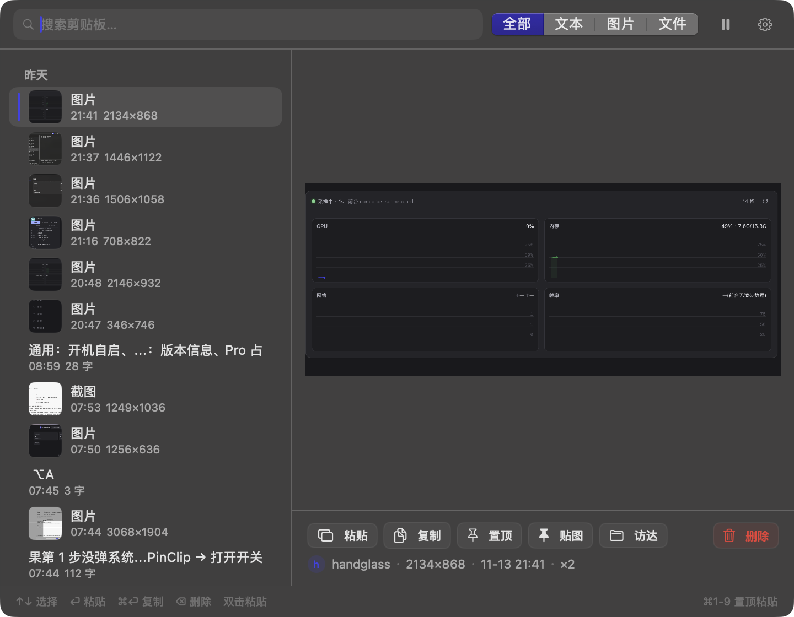
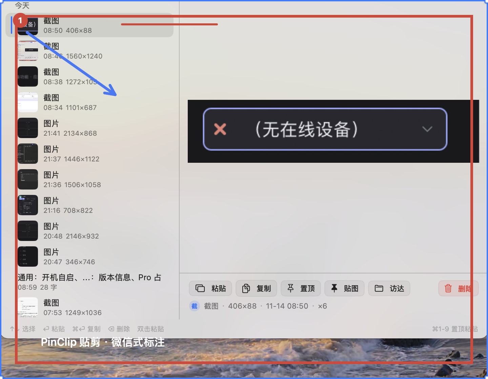
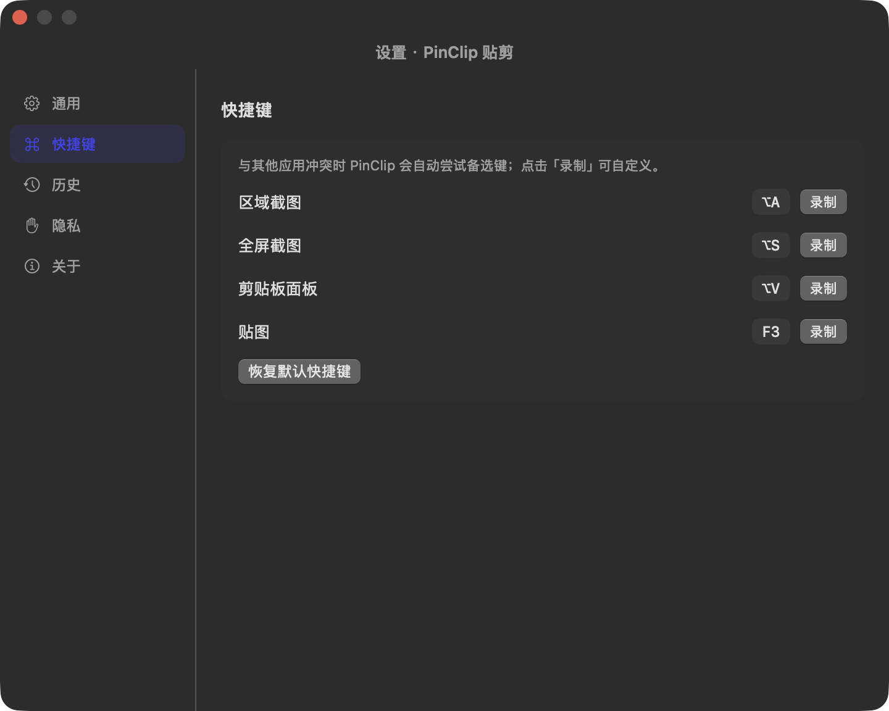

# PinClip 贴剪

> 一个常驻菜单栏图标，搞定「截个图」和「刚才复制过的东西」两件高频小事。
> 截图（微信式标注交互）+ 贴图 + 剪贴板历史，三合一轻量工具 · 全本地处理 · 无遥测

   

## 截图预览

| 剪贴板面板（主从布局） | 截图标注（微信式交互） | 设置 |
|---|---|---|
|  |  |  |

## 功能

### 📋 剪贴板历史（⌥V）

- **三类内容**统一记录：文本 / 图片（含截图）/ 文件
- **SHA-256 内容去重**：重复复制不产生新条目，旧条目自动置顶并累计使用次数（×N）
- **左右主从布局**：左侧摘要列表（图片显示真实缩略图），右侧详情优先展示大图/全文/文件清单
- **来源归属**：记录复制瞬间的最前台应用，显示真实 App 图标；复制链接/URL 时自动提取来源 URL 并显示站点 favicon（直连目标站获取，无第三方服务，可关闭）
- **文本处理工具行**：一键 去换行 / 去空格 / JSON 美化 / URL 解码 / 时间戳→日期（10 位秒 / 13 位毫秒自动识别），处理即复制
- **搜索 + 类型过滤**（全部/文本/图片/文件）+ **置顶收藏**（⌘1-9 快速粘贴置顶项）
- **键盘流**：↑↓ 选择 · ⏎ 粘贴 · ⌘⏎ 仅复制 · ⌫ 删除 · 双击粘贴
- **自动粘贴**：回填剪贴板后向原应用合成 ⌘V（需辅助功能权限，未授权自动降级为仅复制）
- **隐私过滤**：密码管理器来源排除（1Password/Bitwarden/KeePassXC/系统密码）、敏感正则不记录（密码赋值样式 / Luhn 校验通过的卡号 / PEM 私钥）、一键暂停

### ✂️ 截图标注（⌥A 区域 / ⌥S 全屏）

- **微信式交互**：蓝色选区框 + 四角手柄拖拽调整、选区内拖动移动、选区外重新框选、双击完成、实时尺寸角标
- **窗口吸附**：悬停自动高亮对齐应用窗口边界
- **多显示器 + Retina**：每屏独立遮罩（原生 NSWindow，非 WebView），物理像素级清晰
- **标注八件套**：矩形 / 椭圆 / 直线 / 箭头 / 画笔 / 文字 / 马赛克 / 序号（自动步进），6 色调色 + 3 档线宽，⌘Z 撤销
- **三种出口**：✓ 复制（绿） / 保存到桌面 / 贴图——全部自动进入历史流

### 📌 贴图（F3）

- 把剪贴板当前图（或历史最新一张）钉在屏幕上，全空间可见
- 拖动移动 · 滚轮缩放 · ⌘+滚轮调透明度 · 双击菜单（复制/保存/透明度/关闭）
- 同时最多 3 张

### ⚙ 其他

- 菜单栏常驻 + 托盘菜单（暂停记录/设置/退出）
- 快捷键冲突自动降级备选键，设置内可录制自定义热键
- 历史保留策略：文本 500 条 / 图片 30 天 / 置顶永久，孤儿媒体自动清理
- 深浅色主题跟随系统 · 开机自启 · 首启权限引导

## 快捷键

| 动作 | 默认 | 备选（冲突自动降级） |
|---|---|---|
| 区域截图 | ⌥A | ⌥D |
| 全屏截图 | ⌥S | ⌥E |
| 剪贴板面板 | ⌥V | ⌥B |
| 贴图 | F3 | F4 |

全部可在 **设置 → 快捷键 → 录制** 中自定义。

## 首次运行

1. 菜单栏出现 📌 图钉图标（App 为菜单栏应用，无 Dock 图标）
2. 授予**屏幕录制**权限（截图必需）：引导面板 → 打开系统设置 → 勾选 PinClip
3. 可选授予**辅助功能**权限（自动粘贴；不授则降级为仅复制）

## 构建与运行

```bash
# 开发运行
swift run

# 打包 .app（Info.plist / 图标 / ad-hoc 签名）
./scripts/make_app.sh
open build/PinClip.app
```

- 仅需 **Xcode Command Line Tools**（`xcode-select --install`），无需完整 Xcode
- **零第三方依赖**：SwiftUI / AppKit / ScreenCaptureKit / Carbon / SQLite3 / CryptoKit / ServiceManagement
- `swift run` 时 SwiftUI 的 `@State` 宏在 CLT 下不可用，本项目视图层采用 `@Observable` ViewModel + 手动 `Binding(get:set:)` 模式（详见 `Sources/PinClip/Views/`）

## 技术架构

```
Sources/PinClip/
├── AppDelegate.swift              启动与流程编排（菜单栏 App）
├── Models/                        ClipItem / HotkeySpec 等模型
├── Services/
│   ├── Database.swift             SQLite3 C API 轻封装（WAL）
│   ├── HistoryStore.swift         历史库：去重/置顶/保留策略/孤儿媒体清理
│   ├── ClipboardMonitor.swift     NSPasteboard.changeCount 500ms 轮询
│   ├── ClipboardIO.swift          三类内容识别 + 来源 URL 提取 + 写回
│   ├── PrivacyFilter.swift        来源排除 + 敏感正则 + Luhn
│   ├── HotKeyManager.swift        Carbon 全局热键 + 冲突备选降级
│   ├── AutoPaste.swift            辅助功能权限 + CGEvent 合成 ⌘V
│   └── FaviconService.swift       favicon 直连拉取 + 磁盘缓存
├── Capture/
│   ├── ScreenCapture.swift        CGDisplayCreateImage 主路径 + ScreenCaptureKit 兜底
│   ├── OverlayController.swift    每屏原生遮罩窗口（screenSaver 层级）
│   ├── CaptureSession.swift       选区状态机 + 笔画模型 + ImageRenderer 导出
│   └── CaptureOverlayView.swift   遮罩/吸附/手柄/工具条
├── Pin/PinWindowController.swift  贴图 NSPanel 池
├── Panel/PanelController.swift    非激活 NSPanel（呼出不抢焦点）
└── Views/                         SwiftUI 视图（面板/设置/引导）
```

关键实现决策：

- 选区遮罩先截屏（冻结帧）再弹窗，杜绝「截到遮罩自身」
- 标注导出与实时预览共用同一 SwiftUI 渲染组件（`CaptureContentView` + `ImageRenderer`），所见即所得
- 剪贴板面板 `.nonactivatingPanel`：呼出不抢焦点，自动粘贴无需时序处理
- 内容分类启发式：文件 URL > 图片 > 文本；「图片+短文本」视为图片复制、「图片+长文本」视为文本复制

## 路线图

- [ ] OCR 文字识别（离线 Vision 框架，识别后可搜索）
- [ ] 滚动长截图
- [ ] 区域录制导出 GIF
- [ ] iCloud 备份
- [ ] Windows 版

## 隐私承诺

**全本地处理，无遥测，不上传任何数据。** 唯一的网络请求是可选的 favicon 获取（直接请求目标网站，可在设置关闭）。

## License

[MIT](LICENSE)
